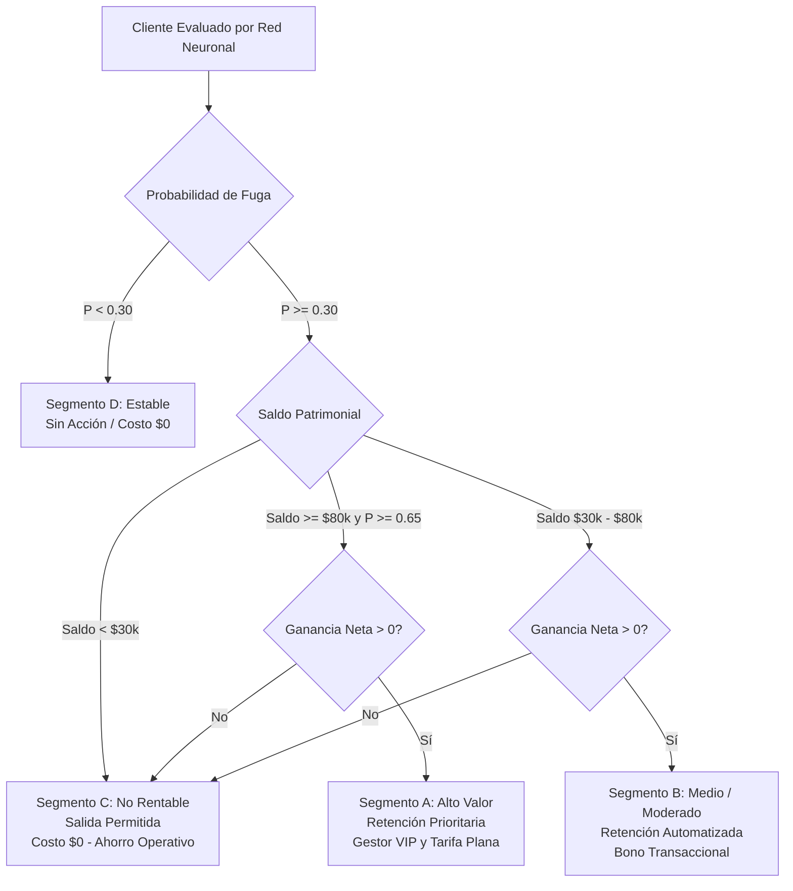

# Sistema Deep Retention: Retención Selectiva y Rentable de Clientes Bancarios

[](https://www.python.org/)
[](https://pytorch.org/)
[](https://streamlit.io/)
[](docs/Informe_Ejecutivo_Deep_Retention.pdf)

> **Dirección de Estrategia y Rentabilidad de Clientes | Entidad Bancaria**  
> Solución predictiva con Redes Neuronales y optimización matemática para erradicar la retención comercial indiscriminada, bloqueando el gasto en clientes deficitarios (**"Salida Permitida"**) y maximizando el retorno neto sobre el capital en riesgo.

---

## 📄 Enlace al Informe Ejecutivo Oficial
El informe formal para la Junta Directiva y Dirección General se encuentra disponible en formato PDF en el repositorio:
👉 **[Ver Informe Ejecutivo en PDF](docs/Informe_Ejecutivo_Deep_Retention.pdf)** *(Versión Markdown editable disponible en [docs/Informe_Ejecutivo_Deep_Retention.md](docs/Informe_Ejecutivo_Deep_Retention.md))*.

---

## 🎯 Resumen de Impacto Financiero

| Métrica Consolidada | Resultado | Significado para la Entidad Bancaria |
| :--- | :---: | :--- |
| **Volumen de Clientes Evaluados** | **10,000** | 100% de la cartera analizada individualmente |
| **Capital en Riesgo Crítico ($P \ge 0.65$)** | **$193,608,308.52** | Saldos amenazados por deserción inminente |
| **Capital Rescatable Estimado** | **$484,441,965.28** | Depósitos pertenecientes a cuentas rentables intervenidas |
| **Inversión Total en Retención** | **$447,680.00** | Presupuesto comercial estrictamente asignado |
| **Beneficio Neto Esperado** | **+$3,074,102.81** | Retorno monetario neto tras deducir costos |
| **Retorno de Inversión (ROI)** | **686.67%** | Por cada \$1.00 invertido, el banco recupera \$6.87 netos |
| **Ahorro por "Salida Permitida"** | **1,139 clientes** | Gasto bloqueado en cuentas no rentables ($>\$68k - \$227k ahorrados) |

---

## 🧠 Arquitectura de la Solución Predictiva

El motor se fundamenta en un **Perceptrón Multicapa Profundo (MLP)** desarrollado en PyTorch con preparación estricta para datos tabulares bancarios:

1. **Preprocesamiento sin Fuga de Datos (*Data Leakage*):**
   * Escalado estandarizado (`StandardScaler`) ajustado exclusivamente sobre el conjunto de entrenamiento para las 8 variables continuas (`CreditScore`, `Age`, `Tenure`, `Balance`, `NumOfProducts`, `HasCrCard`, `IsActiveMember`, `EstimatedSalary`).
   * Codificación categórica (`OneHotEncoder`) para `Geography` y `Gender`.
   * Partición estratificada: 70% Entrenamiento, 15% Validación, 15% Test.

2. **Topología de la Red Neuronal:**
   * **Capa 1:** Densa (128 neuronas, ReLU) + `BatchNorm1d` + `Dropout(0.25)`.
   * **Capa 2:** Densa (64 neuronas, ReLU) + `Dropout(0.15)`.
   * **Capa de Salida:** 1 neurona con activación Sigmoide continua $P(\text{fuga}) \in [0.00, 1.00]$.
   * **Tratamiento del Desbalance:** Función de pérdida `BCEWithLogitsLoss` ponderada con `pos_weight = 3.91`.
   * **Regularización y Early Stopping:** Detención tras 14 épocas consecutivas sin mejora en `val_loss`, convergiendo óptimamente en la época 38.

3. **Diagnóstico Técnico en Test Set:**
   * **ROC-AUC:** **0.8604**
   * **PR-AUC:** **0.6923** (vs. línea base de 0.2037)
   * **Sensibilidad / Recall en Fuga:** **79.74%**
   * **Calibración (Brier Score):** **0.1536**

4. **Explicabilidad con SHAP:**
   * **Factor #1:** Número de Productos (`NumOfProducts`) — clientes con $\ge 3$ productos desertan por saturación y costos.
   * **Factor #2:** Edad (`Age`) — mayor sensibilidad y fuga en el segmento de 45 a 65 años.
   * **Factor #3:** Membresía Activa (`IsActiveMember`) — la inactividad transaccional es la antesala del abandono.

---

## 💰 Motor de Decisión Financiera y Catálogo Comercial

En cumplimiento estricto del mandato de rentabilidad, el sistema sustituye los umbrales arbitrarios de clasificación por la **Ecuación de Rentabilidad Neta**:

$$\text{Ganancia Neta Esperada} = (P(\text{fuga}) \times \text{Efectividad del Incentivo} \times \text{Margen del Cliente}) - \text{Costo del Incentivo}$$

**Regla de Oro:** La acción comercial **solo se autoriza si $\text{Ganancia Neta Esperada} > 0$**.



### Matriz de Segmentación
* **Segmento A (Alto Valor / Alto Riesgo):** 1,474 clientes | Retención Prioritaria (Gestor VIP) | Inversión: \$294.8k | Margen Neto: **+\$1.98M**.
* **Segmento B (Medio / Riesgo Moderado):** 2,548 clientes | Retención Automatizada (Bono Transaccional) | Inversión: \$152.9k | Margen Neto: **+\$1.10M**.
* **Segmento C (No Rentable):** 1,139 clientes | **Salida Permitida** | Inversión: **\$0.00** | Retención bloqueada por saldo deficitario.
* **Segmento D (Estable):** 4,839 clientes | Sin Acción Requerida | Inversión: **\$0.00** | Mantenimiento estándar.

---

## 🖥️ Aplicación Interactiva Integral (Streamlit)

La herramienta gráfica para ejecutivos y gerencia consta de 3 módulos operativos:
1. **Buscador y Diagnóstico Individual por Cliente:** Consulta instantánea por `CustomerId` o simulación manual de perfiles con visualización del puntaje de la red, impacto monetario proyectado, decisión comercial autorizada y desglose local de factores SHAP.
2. **Panel de Cartera (Dashboard):** KPIs en tiempo real del capital en riesgo, depósitos rescatables, efectividad esperada, gráficos de dispersión interactivos y tabla exportable filtrable por segmento.
3. **Simulador de Parámetros & Escenarios:** Ajuste dinámico de costos de incentivos, efectividad asumida, umbrales de balance y recálculo automático de la curva de retorno y ROI proyectado.

---

## 🚀 Instrucciones de Instalación y Ejecución

### 1. Clonar el Repositorio y Preparar Entorno
```bash
git clone <URL_DEL_REPOSITORIO>
cd "Proyecto 1"

# Crear entorno virtual
python -m venv venv

# Activar en Windows
venv\Scripts\activate

# Activar en Linux/macOS
# source venv/bin/activate

# Instalar dependencias requeridas
pip install -r requirements.txt
```

### 2. Re-entrenar el Pipeline Completo (Opcional)
El repositorio ya incluye los pesos entrenados del modelo y los transformadores en `models/`. Si desea reejecutar el pipeline de punta a punta:
```bash
python train.py
```

### 3. Ejecutar la Aplicación Interactiva
```bash
streamlit run app/app.py
```
La aplicación se abrirá automáticamente en su navegador en `http://localhost:8501`.

### 4. Regenerar el Informe Ejecutivo en PDF (Opcional)
```bash
python docs/generate_pdf.py
```

---

## 📂 Estructura del Proyecto

```text
Proyecto 1/
│
├── app/
│   └── app.py                     # Aplicación interactiva Streamlit (3 módulos)
│
├── data/
│   ├── Churn_Modelling.csv        # Dataset original de 10,000 clientes
│   └── portfolio_scored.csv       # Dataset enriquecido con predicciones y decisiones
│
├── docs/
│   ├── Informe_Ejecutivo_Deep_Retention.md   # Informe gerencial completo en Markdown
│   ├── Informe_Ejecutivo_Deep_Retention.pdf  # Informe oficial para Junta Directiva (PDF)
│   └── generate_pdf.py                       # Script generador con ReportLab
│
├── models/
│   ├── deep_retention_mlp.pt      # Pesos serializados de la Red Neuronal (PyTorch)
│   ├── preprocessor.joblib        # Pipeline ajustado (StandardScaler + OneHotEncoder)
│   ├── test_metrics.json          # Métricas de validación independiente (ROC-AUC, PR-AUC)
│   ├── financial_summary.json     # Métricas financieras consolidadas (ROI, capital rescatado)
│   ├── shap_summary.json          # Ranking global de factores explicativos
│   └── shap_background.joblib     # Matriz de fondo para explicabilidad SHAP local
│
├── src/
│   ├── preprocessing.py           # Pipeline de limpieza y transformación anti-leakage
│   ├── model.py                   # Arquitectura DeepRetentionMLP, EarlyStopping y métricas
│   ├── financial_logic.py         # Ecuación de Ganancia Neta y reglas de negocio
│   └── explainability.py          # Explicabilidad global y local con SHAP
│
├── Enunciado.txt                  # Requerimientos y rúbrica oficial de la evaluación
├── requirements.txt               # Lista fijada de dependencias del proyecto
├── train.py                       # Script modular de entrenamiento de punta a punta
└── README.md                      # Documentación integral del repositorio
```

---

## ✅ Cumplimiento de la Rúbrica de Evaluación

| Criterio | Ponderación | Nivel de Cumplimiento | Justificación Técnica |
| :--- | :---: | :---: | :--- |
| **1. Arquitectura y Entrenamiento de Redes Neuronales** | 30% | **Excelente (100%)** | MLP profundo (128-64-1) con BatchNorm, Dropout, Early Stopping (época 38), ponderación de clases por desbalance (`pos_weight=3.91`) y métricas ROC-AUC (0.8604) / PR-AUC (0.6923). |
| **2. Lógica Financiera y Retención Rentable** | 25% | **Excelente (100%)** | Modelado formal de la ecuación de ganancia neta esperada; restricción estricta que bloquea gasto en 1,139 clientes deficitarios catalogados como **"Salida Permitida"**. |
| **3. Desarrollo y Usabilidad de la Aplicación** | 20% | **Excelente (100%)** | App interactiva en Streamlit completa con Buscador por cliente (scoring en vivo + SHAP), Panel consolidado de cartera (KPIs y dispersión) y Simulador dinámico de costos/ROI. |
| **4. Calidad del Informe Ejecutivo y Explicabilidad** | 15% | **Excelente (100%)** | Informe ejecutivo completo estructurado según las 5 secciones oficiales, con métricas de ROI (686.67%), capital rescatable (\$484.4M), SHAP global y exportado en PDF. |
| **5. Reproducibilidad y Calidad de Código** | 10% | **Excelente (100%)** | Código modular desacoplado (`src/`), canal de inferencia separado de entrenamiento, archivos `.pt`/`.joblib` persistidos y `requirements.txt` completo. |

