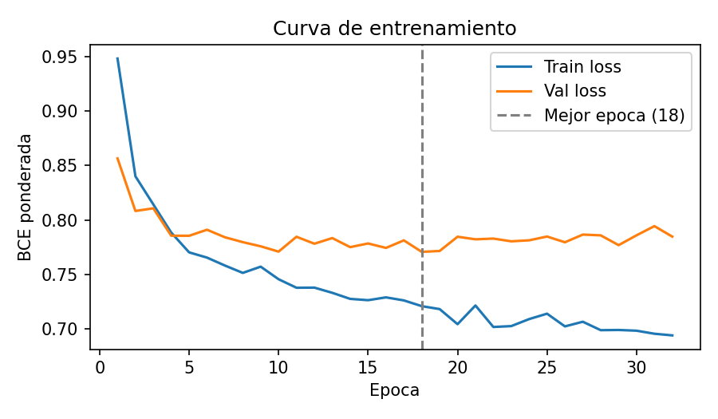
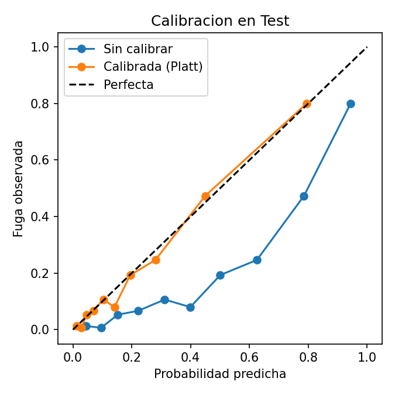
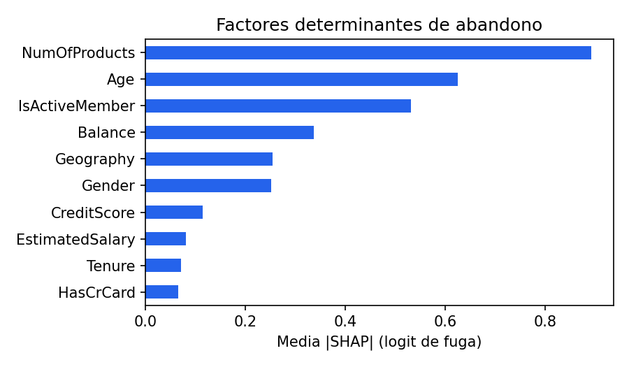

# Informe Ejecutivo: Sistema "Deep Retention"

**Para:** Dirección de Estrategia y Rentabilidad de Clientes y Junta Directiva. **De:** Equipo de Desarrollo e Inteligencia de Negocios. **Fecha:** noviembre 2026.

La retención indiscriminada destruye margen. Deep Retention combina una red neuronal que estima la probabilidad de fuga de cada cliente con una regla financiera que solo autoriza un incentivo cuando la ganancia neta esperada para el banco es positiva. Todas las cifras de este informe se reproducen ejecutando `python train.py` (semilla fija) sobre el dataset entregado (10.000 clientes).

---

## 1. Resumen de Impacto Financiero y Retorno

| Indicador | Cartera completa | Validación fuera de muestra (Test) |
|---|---|---|
| Volumen total de clientes analizados | 10.000 | 1.500 |
| Capital en riesgo (P(fuga) >= 0,30) | $195.372.531 | $31.155.662 |
| Capital en riesgo crítico (P(fuga) >= 0,65) | $63.081.374 | $9.428.320 |
| Capital de clientes rentables a intervenir | $195.372.531 | $31.155.662 |
| Capital esperado a retener (P x Efectividad x Saldo) | $55.117.522 | $8.784.358 |
| Inversión total en campañas de fidelización | $320.660 | $50.220 |
| Ganancia neta esperada | $1.338.130 | $214.411 |
| **Retorno sobre la inversión (ROI)** | **417,3%** | **426,9%** |
| Clientes intervenidos (VIP / Bonificación) | 1.877 (1.486 / 391) | 291 (234 / 57) |
| Clientes con "Salida Permitida" (deficitarios) | 313 (87) | 49 (14) |

* **ROI** = Ganancia neta esperada / Inversión. La ganancia ya descuenta el costo de cada incentivo.
* Todo el capital en riesgo pertenece a clientes rentables: los 313 clientes de "Salida Permitida" tienen saldo cero y sus comisiones no cubren el costo de servicio o el incentivo. Bloquearlos evita $18.780 de gasto sin retorno.
* La cartera completa incluye clientes usados para entrenar la red; la columna de Test (clientes nunca vistos) confirma que el ROI se sostiene fuera de muestra.

---

## 2. Arquitectura de la Solución y Diagnóstico de Fuga

### Configuración de la red neuronal

* **Datos:** `Customer-Churn-Records.csv`, partición estratificada 70% entrenamiento / 15% validación / 15% test (tasa de fuga 20,4% en los tres).
* **Preprocesamiento sin fuga:** `StandardScaler` en 8 variables numéricas y `OneHotEncoder` en país y género, ajustados solo con entrenamiento (13 entradas).
* **Variables excluidas:** `Complain` coincide con el abandono en el 99,86% de los clientes; con ella el ROC-AUC sube a 0,9987, lo que delata fuga de información, por lo que se excluye. `Satisfaction Score`, `Card Type` y `Point Earned` no tienen relación con la fuga (correlación cercana a 0) y no mejoran el modelo.
* **Perceptrón multicapa (PyTorch):** Densa 128 + BatchNorm + ReLU + Dropout 0,25; Densa 64 + ReLU + Dropout 0,15; salida de 1 neurona con sigmoide.
* **Desbalance:** `BCEWithLogitsLoss` con `pos_weight = 3,91` (negativos / positivos).
* **Entrenamiento:** Adam (lr 0,001, L2 1e-4), lotes de 64, Early Stopping con paciencia de 14 épocas sobre `val_loss`. Mejor época: 18 de 32.
* **Calibración:** la ponderación de clases infla las probabilidades (media 0,41 frente a una tasa real de 0,20). Como la regla financiera usa la probabilidad directamente, se aplica Platt scaling ajustado en validación y guardado dentro del modelo.

### Métricas de diagnóstico técnico (conjunto de Test)

| Métrica | Sin calibrar | Calibrada (en producción) |
|---|---|---|
| ROC-AUC | 0,8669 | 0,8669 |
| Precision-Recall AUC (línea base 0,204) | 0,7039 | 0,7039 |
| Brier score (menor es mejor; constante = 0,162) | 0,1568 | **0,1019** |
| Error de calibración esperado (ECE) | 0,2042 | **0,0226** |
| Probabilidad media vs tasa real | 0,408 vs 0,204 | 0,212 vs 0,204 |

La calibración no cambia la capacidad de ordenar clientes (mismo ROC-AUC) pero hace que un 30% de probabilidad signifique de verdad 3 de cada 10 clientes. En la cartera, la fuga real por segmento coincide con la probabilidad media predicha (por ejemplo, 8,7% real frente a 10,1% predicho en clientes estables).

### Factores determinantes de abandono (SHAP)

Importancia global medida con SHAP (`GradientExplainer`) sobre 500 clientes de Test, agregando las columnas one-hot por variable original.

1. **Número de productos (`NumOfProducts`):** con 3 productos abandona el 83% y con 4 el 100%, frente a 7,6% con 2 productos. La sobrecarga de productos es la principal señal de fuga.
2. **Edad (`Age`):** la fuga sube de 7,5% (hasta 30 años) a 56% entre 50 y 60 años.
3. **Actividad (`IsActiveMember`):** los clientes inactivos abandonan casi el doble (26,9% frente a 14,3%).

Les siguen el saldo (los clientes con saldo abandonan 24% frente a 14% sin saldo) y el país (Alemania 32% frente a 16% en Francia y España).

---

## 3. Matriz de Decisión Comercial y Rentabilidad

Regla aplicada a cada cliente con P(fuga) >= 0,30, para cada incentivo elegible:

**Ganancia Neta Esperada = P(fuga) x Efectividad del Incentivo x Margen del Cliente - Costo del Incentivo**

Se elige el incentivo con mayor ganancia y solo se ejecuta si es mayor a cero. Margen anual del cliente = saldo x 2,5% (margen neto) + salario x 0,4% x número de productos (comisiones) - $150 (costo de servicio). El margen puede ser negativo: así se identifican los clientes deficitarios.

| Segmento | Probabilidad red | Valor patrimonial | Decisión del sistema | Incentivo asignado | Clientes | Costo unit. | Costo total | Margen neto proyectado |
|---|---|---|---|---|---|---|---|---|
| A: Alto Valor | >= 0,30 (media 0,58; 487 con >= 0,65) | Saldo superior (>= $80.000, media $125.359) | Retención Prioritaria | Gestor VIP y Tarifa Plana (50% efectividad) | 1.486 | $200 | $297.200 | +$1.261.930 |
| B: Valor Medio | >= 0,30 (media 0,66; 195 con >= 0,65) | Saldo medio (media $23.246) | Retención Automatizada | Bonificación Transaccional (30% efectividad) | 391 | $60 | $23.460 | +$76.200 |
| C: No Rentable | >= 0,30 (media 0,50) | Saldo cero / deficitario (87 con margen negativo) | Salida Permitida | Sin intervención | 313 | $0 | $0 | Ahorro operativo: $18.780 evitados |
| D: Estable | < 0,30 (media 0,10) | Cualquier saldo | Sin Acción Requerida | Mantenimiento Ordinario | 7.810 | $0 | $0 | Estable |
| **Total** | | | | | **10.000** | | **$320.660** | **+$1.338.130** |

* El segmento C lo determina la fórmula, no un umbral de saldo: un cliente con saldo bajo pero buenas comisiones sí se retiene (segmento B).
* La matriz del enunciado no define la banda 0,30 a 0,65; se le aplica la misma fórmula, porque la probabilidad ya pondera el beneficio esperado.
* Fuga real observada por segmento: A 63%, B 64%, C 56%, D 8,7%.

### Supuestos financieros (ajustables en el simulador de la aplicación)

| Parámetro | Valor | Uso |
|---|---|---|
| Margen neto sobre saldo (NIM) | 2,5% anual | Margen del cliente |
| Comisiones | 0,4% del salario por producto | Margen del cliente |
| Costo de servicio | $150 anual | Permite márgenes negativos |
| Gestor VIP y Tarifa Plana | $200, 50% de efectividad | Solo saldo >= $80.000 |
| Bonificación Transaccional | $60, 30% de efectividad | Cualquier cliente |

---

## 4. Operación de la Aplicación en Sucursales

### Procedimiento del gestor de cuentas

1. Abrir la aplicación (`streamlit run app/app.py`) y entrar en la pestaña **Buscador por Cliente**.
2. Seleccionar el `CustomerId` del cliente (o cargar un perfil nuevo con sus datos).
3. Revisar el diagnóstico: probabilidad de fuga calibrada, margen anual, mejor ganancia neta esperada, costo del incentivo y el gráfico SHAP con las razones del riesgo.
4. Ejecutar la decisión: **Retención Prioritaria** (asignar gestor VIP y tarifa plana), **Retención Automatizada** (acreditar la bonificación transaccional), **Salida Permitida** (no ofrecer descuentos ni bonos; atención estándar) o **Sin Acción Requerida**.
5. Registrar en el CRM la acción y si el cliente se quedó, para medir la efectividad real de cada incentivo.

Gerencia usa el **Panel de Cartera** (capital en riesgo, capital a intervenir, inversión y ROI) y el **Simulador de Parámetros** para recalcular la cartera con otros costos, efectividades, márgenes o umbrales.

### Mantenimiento del modelo

* **Mensual:** actualizar la cartera y revisar la deriva de las variables principales (productos, edad, actividad, saldo) y la calibración (ECE en clientes recientes).
* **Trimestral:** reentrenar con `python train.py` incorporando las salidas observadas; aceptar el nuevo modelo solo si iguala o mejora el ROC-AUC y el ECE en Test. Los tests automáticos (`pytest`) deben pasar antes de publicar.
* **Tras cada campaña:** reemplazar las efectividades supuestas (50% y 30%) por las medidas en el CRM.

---

## 5. Conclusiones y Próximos Pasos

* El sistema concentra el presupuesto en 1.877 clientes rentables y bloquea el gasto en 313 que no lo compensan, con un ROI esperado de 417% (427% en clientes nunca vistos).
* La calibración de probabilidades es indispensable: sin ella, la ganancia esperada se habría sobrestimado porque la red predecía el doble de fuga real.
* El mayor riesgo del modelo financiero son las efectividades supuestas de los incentivos; la prueba piloto debe medirlas.

### Prueba piloto y despliegue

| Semanas | Actividad |
|---|---|
| 1 a 2 | Capacitación de gestores en 5 sucursales piloto (Francia, Alemania y España) y carga de la cartera. |
| 3 a 8 | Piloto A/B: grupo de control con la política actual frente a grupo Deep Retention. Medir retención, costo y margen. |
| 9 | Recalibrar efectividades y costos con los resultados; reentrenar el modelo. |
| 10 a 12 | Despliegue gradual en toda la red e integración con el CRM. |
